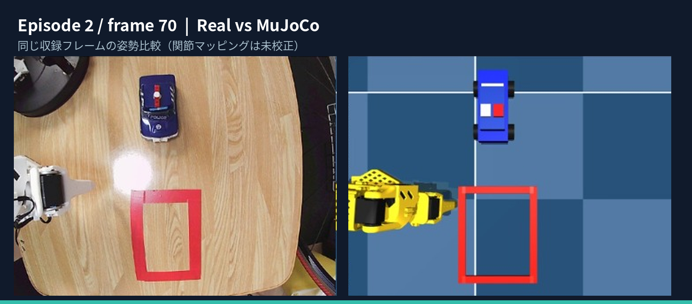

# SO-101 ACT Real-to-Sim — Physical AI 2026

**Status:** research prototype / simulation-only. The SO-101 physical robot was used to *record demonstrations*, not to execute the ACT policy in this repository.

A Japanese research report is available at [`report/SO101_Real_to_Sim_Final_Report.pdf`](report/SO101_Real_to_Sim_Final_Report.pdf). The 2m17s submission video is distributed separately from this source-code ZIP.



*Same episode frame 70; image-layout approximation only, no calibrated visual pose accuracy.*

## Research objective and verified results

- **Task:** move a blue miniature car into a red goal frame with SO-101. The recorded **human-guided demonstration** shows the car entering the goal.
- **Dataset:** LeRobot Dataset v3.0, 10 episodes × 450 frames = 4,500 frames at 15 FPS; top camera 640×480; 6-axis state/action. **Dataset is not in this repository.**
- **ACT:** No-VAE policy trained on the real dataset; 6,000 / 8,000 / 10,000 step checkpoints evaluated. 6,000 yielded the lowest five-axis mean in-sample offline MAE of the three. **Weights are not in this repository.**
- **Real-to-Sim:** MuJoCo SO-101 joint dynamics and approximate tabletop layout, teacher trajectory replay, and offline ACT prediction replay.
- **Fixed-image ACT rollout:** ACT is re-inferred with updated simulated joint state but a *fixed prerecorded real camera frame*. In a 30-second run, the arm moved slightly at the start and became nearly stationary. This is not visual closed-loop control.

## Results (Episode 2, training-side episode under the single-task split assumption)

| Joint | ACT MAE (deg) | Hold position MAE (deg) |
|---|---:|---:|
| shoulder_pan | 4.887 | 1.864 |
| shoulder_lift | 7.502 | 2.410 |
| elbow_flex | 5.497 | 2.921 |
| wrist_flex | 1.977 | 1.219 |
| wrist_roll | 0.773 | 0.424 |

Five-axis means: **ACT 4.126°** vs **hold 1.768°** (450 frames). The recorded gripper observation is nearly constant and has an incompatible scale with action, so it is not included in angle-based aggregation.

In a shared subset of 420 frames, ACT vs teacher had MAE 4.262° at lag 0 and 2.923° at lag +9 frames (0.6 s); the recorded teacher command vs measured joint state was closest at +3 frames (0.2 s) overall. **Exploratory lag minimization is not proof of timestamp misalignment.** Details: [`results/temporal_audit.md`](results/temporal_audit.md).

## What was *not* demonstrated

- Autonomous car movement into the goal was **not** achieved in MuJoCo.
- Car and goal are **visual-only static objects** with no pushing dynamics or success detector.
- The ACT prediction replay in the split-screen movie is **teacher-forced/offline**, not a policy rollout.
- The joint mapping (`degrees` → `radians`, positive signs, zero offsets) is **provisional and uncalibrated**. A speculative +15° correction was tested visually but rejected.
- Accuracy was measured on Episode 2. For a single-task dataset with episodes 0..9, LeRobot v0.6.1 and `eval_split=0.2` put episodes 0..7 in training and 8..9 in eval; task membership and actual split logs are not bundled. Held-out generalization and task success remain unverified.

## Repository layout

```text
configs/                 Provisional 6-axis state/action mapping
src/                     MuJoCo, ACT offline evaluator, replay, lag analysis
results/                 Observed offline numbers, checkpoint & lag summaries
figures/                 Research comparison images
media/                   Example split-screen trajectory comparison (submission video distributed separately)
report/                  Detailed report (PDF)
tests/                   Lightweight static safety checks
```

## Reproduction (Windows PowerShell)

The original project used separate Python venvs: `C:\SO101\.venv-mujoco` (MuJoCo 3.2.5) and `C:\SO101\.venv-act` (LeRobot 0.6.1 / PyTorch). Python scripts must be invoked with the correct interpreter. External assets and dataset paths below are placeholders and **must be changed to local paths**. No physical hardware is accessed.

```powershell
$Repo = 'D:\SO101\so101-act-real-to-sim'
$SimPy = 'C:\SO101\.venv-mujoco\Scripts\python.exe'
$ActPy = 'C:\SO101\.venv-act\Scripts\python.exe'
$Scene = 'C:\SO101\sim_models\SO-ARM100\Simulation\SO101\scene.xml'
$Data = 'D:\SO101\datasets\so101_car_fullgoal_10ep_20261101_100029'
$Ckpt = 'D:\SO101\outputs\act_fullgoal_novae_resume_5000_to_10000\checkpoints\006000\pretrained_model'
$Map = Join-Path $Repo 'configs\mapping_candidate_UNVERIFIED.json'

# Inspect joint ordering and ranges (simulation only).
& $SimPy (Join-Path $Repo 'src\so101_sim.py') --mode inspect --scene $Scene

# Build the visual-only car/goal scene beside scene.xml.
& $SimPy (Join-Path $Repo 'src\create_so101_car_goal_scene.py') --scene $Scene --car-x 0.20 --car-y -0.08 --goal-x 0.37 --goal-y -0.08

# Create real-image-layout approximation from the visual-only scene.
$Visual = Join-Path (Split-Path $Scene) 'scene_car_goal_visual.xml'
& $SimPy (Join-Path $Repo 'src\so101_align_car_goal_to_real.py') --scene $Visual
# Camera projection and object sizes are approximate, not calibrated.

# Evaluate teacher-forced ACT predictions on Episode 2 (no simulator).
& $ActPy (Join-Path $Repo 'src\so101_act_offline_eval.py') --dataset $Data --checkpoint $Ckpt --episode 2 --stride 1 --output 'D:\SO101\offline_eval' --device cpu

# Fixed-image ACT rollout (no physical robot and NOT a visual closed loop):
& $SimPy (Join-Path $Repo 'src\so101_sim.py') --mode act --scene $Scene --act-python $ActPy --dataset $Data --checkpoint $Ckpt --mapping $Map --dataset-frame 1218 --frames 45 --max-step-rad 0.02 --output 'D:\SO101\fixed_image_rollout'

# Offline replay: requires the full stride-1 predictions.csv and
# visual-scene filename containing car_goal_top camera.
$Pred = 'D:\SO101\offline_eval\predictions.csv'
$VisualScene = 'C:\SO101\sim_models\SO-ARM100\Simulation\SO101\scene_car_goal_real_layout.xml'
& $SimPy (Join-Path $Repo 'src\so101_teacher_vs_act_replay.py') --csv $Pred --scene $VisualScene --mapping $Map --start-frame 70 --frames 300 --fps 15 --max-step-rad 0.10 --camera car_goal_top --video 'D:\SO101\teacher_vs_act.mp4'
```

### External dependencies and source attribution

Do not vendor third-party MJCF/meshes or pretrained weights without checking their licenses. Fetch the robot model from [TheRobotStudio SO-ARM100](https://github.com/TheRobotStudio/SO-ARM100/tree/main/Simulation/SO101) and LeRobot from [Hugging Face LeRobot](https://github.com/huggingface/lerobot). See [MuJoCo documentation](https://mujoco.readthedocs.io/).

**Privacy:** Do not commit raw camera episodes, private identifiers, COM logs, local credentials, ML cache or full checkpoints. `.gitignore` excludes many such extensions, but inspect `git status` before pushing.

**Video:** The revised release uses real images as labeled still frames; it does not simulate photographic motion. Both split-screen branches are trajectory replays.

**Licensing:** Original scripts do not yet have a selected license. **No LICENSE is included**; select one before granting reuse rights.

## Model training settings and provenance (verified checkpoint settings)

| Field | Value / evidence |
|---|---|
| Framework / policy | LeRobot v0.6.1, ACT **No-VAE** (saved `config.json`) |
| Backbone / transformer | ResNet18, dim_model=128, encoder=2 layers, decoder=1 layer |
| Chunk / saved action steps | `chunk_size=20`, `n_action_steps=20` |
| Offline evaluation | Override `n_action_steps=1` to compare chunk-first action to teacher action at each timestep |
| Optimizer | AdamW, LR=1e-5, weight_decay=1e-4, betas=(0.9,0.999), eps=1e-8, grad_clip_norm=10 |
| Batch / seed / logging | batch_size=1, seed=1000, log_freq=100, W&B disabled |
| Scheduler | no scheduler entry in the saved configuration (null / unset) |
| Image augmentation | `dataset.image_transforms.enable=false`; `use_imagenet_stats=true` |
| Dataset split | `eval_split=0.2`; LeRobot v0.6.1 holds out the last `ceil(n*0.2)` episodes **per task**. If all 10 episodes are one task: train 0..7 and eval 8..9. Verify per-episode task metadata before asserting the split. |
| No-VAE initial run | `act_fullgoal_novae_fresh_5000_20261101_192814`, checkpoint 005000: `resume=false`, no `checkpoint_path`, no `pretrained_path`; trained independently of the VAE run |
| No-VAE resumed run | `act_fullgoal_novae_resume_5000_to_10000`; PowerShell history specifies `--config_path` of the fresh 005000 training config, `--resume=true`, `--steps=10000`. Checkpoints 006000..010000 exist. |
| Chosen policy | No-VAE checkpoint **006000** for the reported Episode 2 comparisons |
| Separate VAE run | `act_fullgoal_2000_20261101_102606` checkpoints 001000..005000 have `use_vae=true`, KL weight=10; its 2k..5k training log must **not** be merged into No-VAE loss charts. |
| Not verified | No-VAE scalar training-loss curve, exact training GPU, total wall-clock training duration, whether ResNet18 backbone initial weights were pretrained. |

The resumed No-VAE command (recorded in PowerShell history) was:

```powershell
$CheckpointConfig = 'D:\SO101\outputs\act_fullgoal_novae_fresh_5000_20261101_192814\checkpoints\005000\pretrained_model\train_config.json'
& 'C:\SO101\.venv-act\Scripts\lerobot-train.exe' "--config_path=$CheckpointConfig" '--resume=true' '--steps=10000' '--output_dir=D:\SO101\outputs\act_fullgoal_novae_resume_5000_to_10000' '--job_name=act_fullgoal_novae_resume_10000'
```

This is a recorded **resume** command, not a reconstructed command for the initial fresh run. No-VAE loss history for steps 5,000..10,000 has not been located. Saved optimizer learning rate does not prove the exact time series of effective learning rates.

For split behavior in the exact LeRobot version, refer to [`v0.6.1/src/lerobot/datasets/factory.py`](https://github.com/huggingface/lerobot/blob/v0.6.1/src/lerobot/datasets/factory.py), `make_train_eval_datasets`.

## Important local files not yet packaged

`results/ep2_predictions.csv` and `results/ep2_metrics.json` are **not present** in this release (they exist only on the Windows PC). The lag audit and exact offline replay therefore cannot be reproduced from the ZIP alone. Instructions to copy them: `results/IMPORT_LOCAL_RESULTS.md`. Do not state that this repository is fully reproducible until these are included (or independently regenerated from the private dataset and checkpoint).
